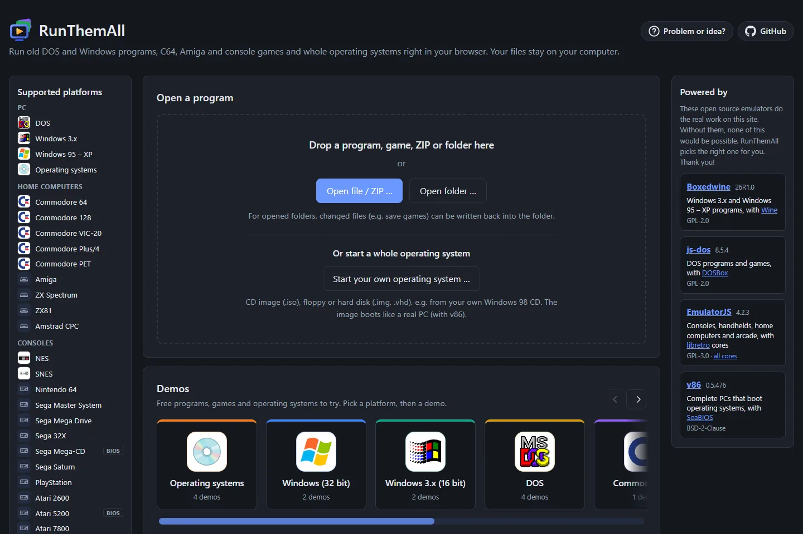
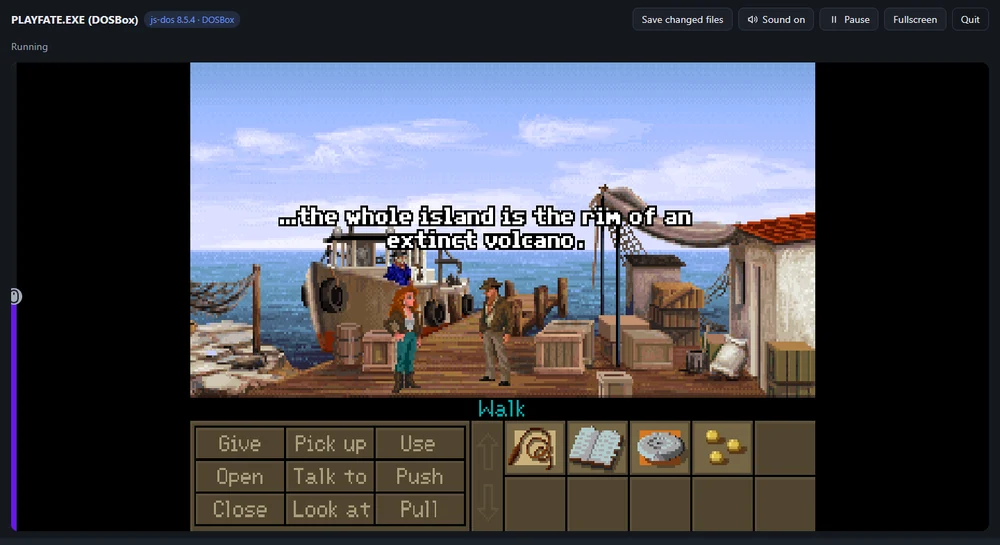
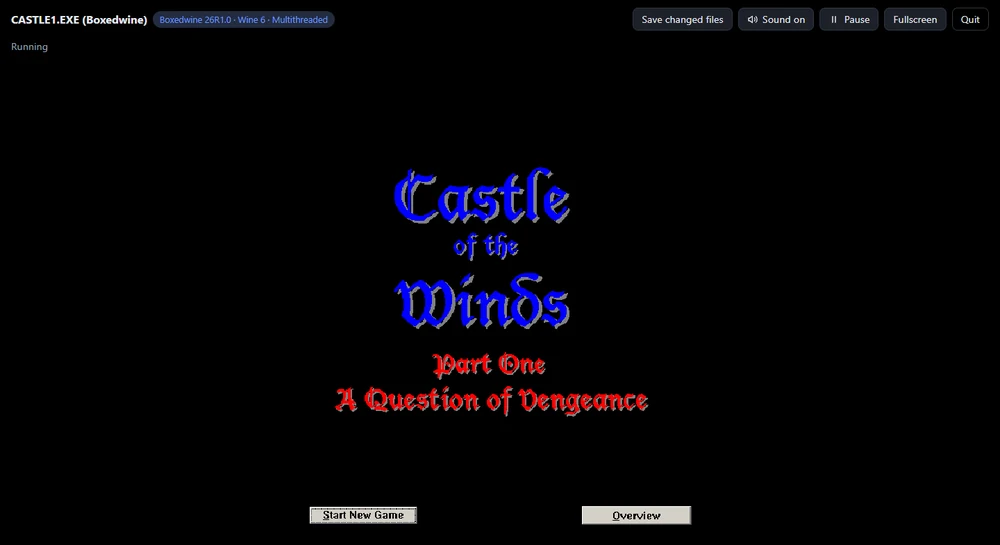
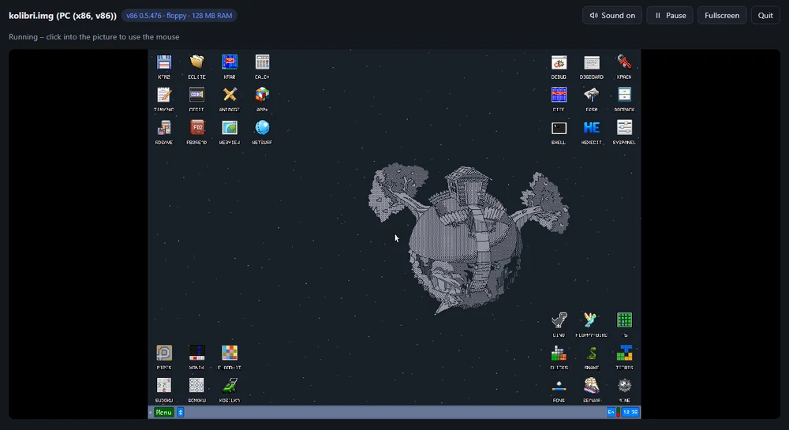
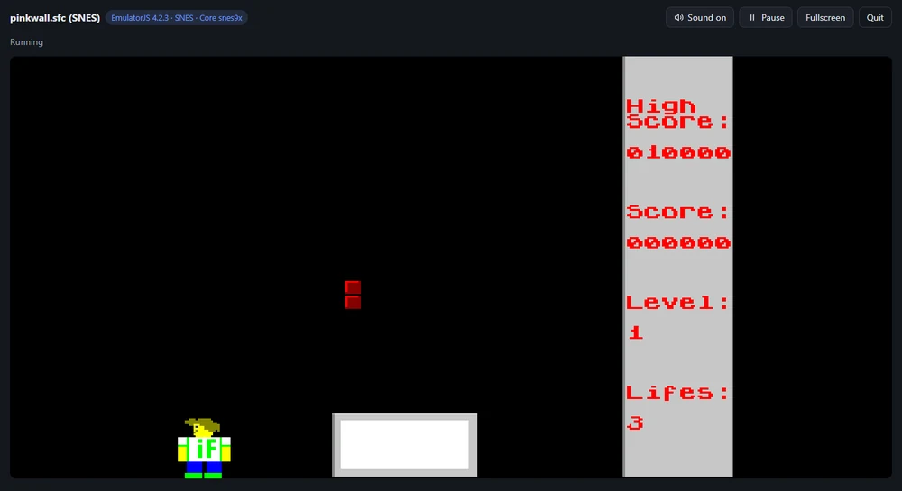

# RunThemAll

### ▶️ [Use it now: ralf1108.github.io/RunThemAll](https://ralf1108.github.io/RunThemAll/)

**Play old DOS and Windows programs, retro console games and whole operating systems right in your
browser. Nothing to install, nothing uploaded.**

## How to use it

1. **Open** a file, a ZIP or a folder, or just drag it onto the page.
2. **Pick** the program or game. RunThemAll finds out by itself what it is.
3. **Start.** The right emulator is loaded for you.

No time? Click one of the **demos** and press **Start**.

## What it looks like

<table>
  <tr>
    <td width="50%"> <b>DOS</b>: Indiana Jones and the Fate of Atlantis (demo)</td>
    <td width="50%"> <b>Windows 3.x</b>: Castle of the Winds</td>
  </tr>
  <tr>
    <td> <b>A whole operating system</b>: KolibriOS</td>
    <td> <b>Super Nintendo</b>: Pink Wall</td>
  </tr>
</table>

## What runs?

- **DOS** programs and games
- **Windows 3.x** and **Windows 95 – XP** programs
- **Home computers**: Commodore 64, Amiga, ZX Spectrum, Amstrad CPC and more
- **Consoles and handhelds**: NES, SNES, N64, Game Boy, Game Boy Advance, Nintendo DS, Sega,
  PlayStation, Atari and more
- **Arcade** games
- **Whole operating systems** from a CD, floppy or hard disk image, e.g. Linux, ReactOS or your own
  Windows 98 CD

The page lists all 41 platforms on the right. Details and file types: [docs/systems.md](docs/systems.md)

## Demos

Free games, programs and operating systems, ready to try:

- **Operating systems**: Tiny Core Linux, KolibriOS, ReactOS, a DOS prompt
- **Windows**: SkiFree, OpenTTD, Castle of the Winds 1 and 2
- **DOS**: Keen Dreams, Dark Forces, Indiana Jones and the Fate of Atlantis, Boppin'
- **Retro**: T-Rex 64 (C64), Pink Wall and Horizontal Shooter (SNES), Nova the Squirrel (NES), µCity (Game Boy Color)

Where they come from: [demos/README.md](demos/README.md)

## Tips

- **No sound?** Click once into the picture. Browsers only play sound after a click.
- **Buttons while playing**: *Save*, *Sound on/off*, *Play/Pause*, *Console*, *Fullscreen*, *Quit*.
  Green means sound on or running, red means sound off or paused.
- **Mouse in operating systems**: click into the picture to use the mouse, `Esc` releases it.
- **Save games**: *Save* shows the files the program changed. Download it as a ZIP or, in Chrome or
  Edge with an opened folder, write it back directly (*Apply to folder*).
- **Settings**: every demo has an *Options* button (speed, memory, Windows version).

## Good to know

- Emulation is slower than a real PC. It is made for older software.
- Windows programs with **3D graphics** (OpenGL, Direct3D), .NET or Java do not work.
- A few consoles need an original **BIOS file** (marked "BIOS" on the page). You have to add it yourself.
- Programs inside the emulator **cannot go online**.
- Works best in **Chrome or Edge**.
- Something does not work, or you have an idea? [Open an issue](https://github.com/Ralf1108/RunThemAll/issues/new/choose).

## Privacy

- Everything runs in your browser. Your files are **never uploaded**.
- Page visits are counted anonymously and without cookies ([GoatCounter](https://www.goatcounter.com)).

## Behind the scenes

RunThemAll puts one simple page on top of these great open source emulators:

- [Boxedwine](https://github.com/danoon2/Boxedwine) with [Wine](https://www.winehq.org): Windows programs
- [js-dos](https://js-dos.com) with [DOSBox](https://www.dosbox.com): DOS programs
- [EmulatorJS](https://emulatorjs.org) with [libretro](https://www.libretro.com) cores: consoles, home computers, arcade
- [v86](https://github.com/copy/v86) with [SeaBIOS](https://www.seabios.org): complete PCs

Thanks to all of them and to the authors of the demos.

For developers:

- [docs/development.md](docs/development.md): run it locally, update the emulators, publish it
- [docs/specification.md](docs/specification.md): how it works inside
- [THIRD_PARTY_NOTICES.md](THIRD_PARTY_NOTICES.md): all included projects and their licences

## Licence

RunThemAll is free software under the [MIT licence](LICENSE). The included projects have their own
licences, see [THIRD_PARTY_NOTICES.md](THIRD_PARTY_NOTICES.md).
